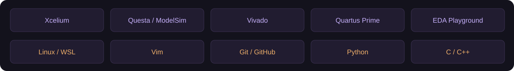
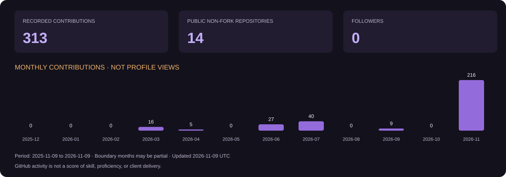

  

  <strong>Electronics Engineer · M.Engg. Candidate — Integrated Circuit Design, NED University</strong> 
  Karachi, Pakistan · Open to freelance RTL and verification projects

  
  
  

  

## ABOUT ME

I am **M. Roohan Khan**, an Electronics Engineering graduate and **M.Engg. candidate in Electronic Engineering, specializing in Integrated Circuit Design at NED University of Engineering & Technology**.

I enjoy translating digital-system requirements into RTL, building testbenches, and investigating what the waveforms actually show. My work and project interests focus on **Verilog/SystemVerilog, digital interfaces, memory subsystems, FPGA development, and RISC-V-based systems**.

I am open to **freelance RTL development, simulation debugging, and self-checking testbench work** within a clearly agreed scope. I am also developing my depth in **UVM, SystemVerilog assertions, and coverage-driven verification**.

## ENGINEERING FOCUS

| RTL & digital systems | Verification & debugging | Development workflow |
| :--- | :--- | :--- |
| Verilog / SystemVerilog | Self-checking testbenches | Linux through WSL |
| FSMs, registers and memories | Directed and corner-case tests | Vim, Git and GitHub |
| APB, AHB-Lite and AXI4-Lite projects | Scoreboards and waveform analysis | Reproducible simulation scripts |
| FPGA and RISC-V learning projects | Building UVM / SVA / coverage skills | Specifications, logs and limitations |

## TOOLS & WORKSPACE

**Simulation and verification:** Cadence Xcelium, Questa / ModelSim, EDA Playground.  
**FPGA workflow:** AMD Vivado and Quartus Prime.  
**Programming and automation:** Python, C/C++, shell scripting, Linux / WSL, Vim, Git.

Tools are listed as part of my workspace and learning workflow. Each project documents the simulator actually used and its measured results.

## SELECTED WORK

| Project | What to explore |
| :--- | :--- |
| [RV32I-Subset SoC with AXI4-Lite SRAM](https://github.com/M-Roohan-Khan-28/RV32I-AXI4-Lite-SoC) | Bounded CPU/bus/memory integration with 24 directed runs plus required checker qualification (1 legal, 8 expected-negative); complete ISA verification remains open. |
| [AXI4 DMA Subsystem](https://github.com/M-Roohan-Khan-28/AXI4-DMA-Subsystem) | Bounded 64-bit memory-to-memory DMA with 32-bit control; 40 deterministic cases and 1,352,655 checks, including independent AW/W progress and address/burst progression oracles. |
| [AMBA Protocol Verification](https://github.com/M-Roohan-Khan-28/AMBA-Protocol-Verification) | Reusable portable APB, AHB-Lite and AXI checkers and drivers; 11 internal simulations passed against pinned DUT sources. |
| [Two-Core Coherent Memory Milestone](https://github.com/M-Roohan-Khan-28/RV32I-Coherent-Memory-SoC) | Bounded write-through shared-memory subsystem: 71 scenarios, 135 staged and 106 concurrent core checks, plus bridge/reset/shared-address tests; the inherited full AXI SoC remains unverified. |
| [AXI4-Lite Master and Slave Memory Interface](https://github.com/M-Roohan-Khan-28/AXI4-Lite-Memory-Interface) | Standalone master/slave SRAM path with independent channel handshakes and seven functional ModelSim tests plus required checker qualification (1 legal, 8 expected-negative). |
| [APB RAM Interface and Verification](https://github.com/M-Roohan-Khan-28/APB-Interface-Verification) | Interface-based RTL with 2,697 deterministic contract checks over 673 accepted transfers. |
| [APB RAM with Master and Slave Modports](https://github.com/M-Roohan-Khan-28/APB-Modports-Verification) | Master/slave signal-direction exercise with 12,488 independent checks. |
| [AHB-Lite RAM Interface and Directed Verification](https://github.com/M-Roohan-Khan-28/AHB-Lite-RAM-Interface) | Bounded 16-word RAM contract with two-cycle ERROR response, 924 comparisons and three malformed-master wait tests. |
| [Two-Way Set-Associative Cache RTL](https://github.com/M-Roohan-Khan-28/Two-Way-Cache-RTL) | Two-way tag/data lookup with 1,639 independent checks. |
| [VGA Timing Controller with SRAM Framebuffer](https://github.com/M-Roohan-Khan-28/VGA-SRAM-Framebuffer) | Bounded raster/framebuffer model: 29,588,940 pin comparisons across two frames, eight reset-edge temporal checks and four measured boundary captures. |
| [8-Bit ALU RTL and Verification](https://github.com/M-Roohan-Khan-28/ALU-RTL-Verification) | Arithmetic/logic RTL with 524,288 exhaustive input tuples and 1,579,002 comparisons. |
| [Food Court Kiosk — final-year project](https://github.com/M-Roohan-Khan-28/foodcourt-kiosk-fyp) | My existing cloud-based kiosk project. |

The ALU, APB, AHB-Lite, cache, and VGA projects preserve source from the original HDL collection. The standalone AXI4-Lite interface was extracted from the RV32I-subset SoC. The DMA and coherent-memory projects retain their permitted upstream source history and attribution. Each repository records its source provenance, tested configuration, results, and limits.

**Locked 11-project aggregate:** [Published technical regression summary](https://github.com/M-Roohan-Khan-28/AMBA-Protocol-Verification/blob/73e948a3f9f200b590421afe5893d055a000d33b/reports/technical-release-2026-11-08/RELEASE_SUMMARY.md) records all 11 required project suites passing at the merged-main full-SHA locks in runner `9820035daf9a63f5bbf4fa14c2621a65a746cd85`. The two original advanced ALU and APB environments remain **NOT RUN** because the required `svverification` licence is unavailable. These bounded simulation results do not establish complete protocol or ISA verification, coverage closure, synthesis, timing, FPGA, or hardware operation.

## CURRENT DIRECTION

I am expanding my portfolio through **independently runnable RTL blocks**, **reusable verification environments**, and **clear engineering documentation**. My next verification milestones include stronger assertion checks, functional coverage analysis, and UVM-based APB and AXI4-Lite environments.

## GITHUB ACTIVITY

Activity cards use GitHub data. Monthly contribution totals are not monthly profile views and are not measures of engineering proficiency.

## CONTRIBUTION SNAKE

Animation: [Platane/snk](https://github.com/Platane/snk). The view badge is a separate third-party counter, not GitHub's official unique-visitor analytics.

## LET'S CONNECT

For scoped RTL development, testbench work, debugging, or collaboration, reach me through **[LinkedIn](https://www.linkedin.com/in/m-rouhan-khan-mxr28/)** or **[email](mailto:rouhan28may@gmail.com)**. A useful starting brief includes the interface specification, expected behaviour, target simulator, and acceptance tests.

---

<em>Define the behaviour. Build the design. Check the evidence.</em>

