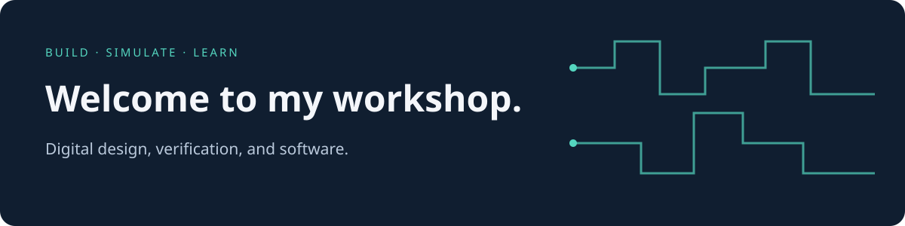

# Hi, I'm Roohan 👋

I'm learning by building: writing RTL, checking what happens in simulation, and turning ideas into working software. This is where I keep my projects and the notes that make them easier to understand and run.

### What I'm working on

- **[HDL labs](https://github.com/rouhan28may-droid/hdl-labs):** Verilog and SystemVerilog modules, memory interfaces, and testbenches.
- **[RISC-V AXI SoC](https://github.com/rouhan28may-droid/riscv-axi-soc):** a small RISC-V processor with an AXI4-Lite SRAM interface; its 21-run portable regression passes in ModelSim.
- **My final-year project:** [Food Court Kiosk](https://github.com/rouhan28may-droid/foodcourt-kiosk-fyp).

### Around here

I like projects with a clear starting point: what they do, how to run them, and what has actually been tested. I'm organizing my hardware labs with source code, simulation scripts, and verification notes so they're useful to revisit and share.

If you're exploring similar topics, feel free to browse the code or open an issue in the relevant repository. Questions and practical suggestions are welcome.

Thanks for stopping by.
